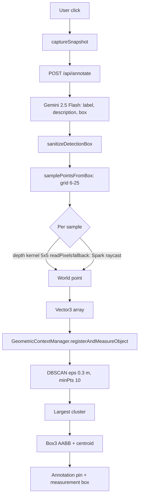
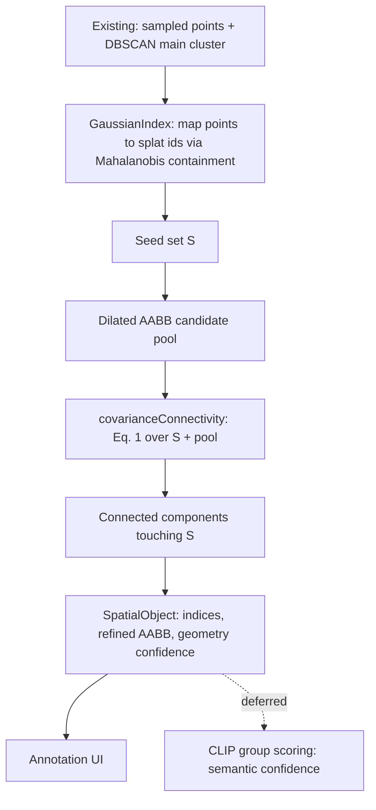

# VLSplat-Inspired Gaussian Refinement: Investigation Report

Status: investigation only. No source files were modified. Implementation awaits approval.

- Base branch: `main`
- Scene scope: `Apartment.sog` only
- Paper: VLSplat, arXiv 2611.01939v1
- SparkJS version: `@sparkjsdev/spark` 2.0.0

## Caveats on evidence

- The local PDF could not be parsed (no PDF tooling installed). The paper was read through its arXiv HTML via a subagent.
- Sections 3.1–3.3, Eqs. 1–6 and the ablation tables are verbatim from the page.
- Appendix C (view settings, thresholds) and Table 6 (runtime/memory) came only from a model-generated summary. Treat them as less reliable.
- Appendices A, B and E were not read.
- Items marked **(inferred)** are my reasoning from code reading, not runtime-verified.

---

## A. Architecture (as it exists on `main`)

Pipeline: click → snapshot → Gemini box → grid sampling (raycast + depth kernel) → DBSCAN → largest cluster → AABB → DOM annotation pin.

Key facts:

- `src/script.ts` (`SplatViewer`): click handler, `getAnnotationPosition` (raycast), `getDepthKernel`, `samplePointsFromBox`, `annotateFromDetection`, `requestAnnotationFromGemini`.
- `GeometricContextManager.ts`: only `registerAndMeasureObject` is used. `registerObjectPoints`, `getTargetInstance`, `getTargetSofaInstance` and `spatialDatabase` are dead code.
- Backend `gemini-VLM-annotations/server.ts`: Express `POST /api/annotate`, `gemini-2.5-flash` with a JSON schema `{objects:[{label,description,box}]}`. Box is `[ymin,xmin,ymax,xmax]`, normalized 0–1 (0–1000 outputs are rescaled). A second implementation exists in `netlify/functions/annotate.ts` (not fully reviewed).
- The mesh is loaded with `quaternion (1,0,0,0)` and `position y = -1.5`, so splat-local space differs from world space. World covariance is Σ_world = M Σ Mᵀ.

The WebGPU scaffold described in the brief exists only on branches (`origin/experiment/dimension-identification`): `WebGPUComputeService`, `GPUBufferPool`, a 48-byte `CandidatePoint` layout, `pack.ts`. It has no passes, no WGSL and no instantiation on `main`. That branch also changes the backend contract and loads a removed PLY, so it must not be merged wholesale.

## B. Component assessment

| Component | State | Assessment |
|---|---|---|
| Click → snapshot → Gemini | Working | Fine for this scope. |
| Raycast sampling | Working | Spark raycast returns only distance/point/object, no splat index. `minRaycastOpacity` defaults to 0.2. |
| Depth kernel (`readPixels` with `DEPTH_COMPONENT`) | **Probably non-functional (inferred)** | Reading depth via `readPixels` is, to my recollection, not valid in WebGL. Spark also does not write depth by default (`depthWrite` false). Needs a `gl.getError()` runtime check. |
| DBSCAN (eps 0.3, minPts 10) | Working | Trivial cost on at most 625 points. Drops noise and retains no indices. |
| AABB | Working | Axis-aligned in world space only. |
| WebGPU scaffold | Branch-only, unused | No compute passes. `readbackBuffer` allocates a staging buffer per call. `destroy` does not destroy the device. |
| CandidatePoint provenance | Not on `main` | On the branch it is discarded when mapped back to `Vector3[]`. |

Likely bottleneck **(inferred, not benchmarked)**: up to 625 raycasts, each O(N) over splats, plus 25 `readPixels` per sample.

## C. Gaussian data accessibility (SparkJS 2.0.0)

| Data | Accessible? | Route | Notes |
|---|---|---|---|
| Centre μ | Yes (CPU) | `packedSplats.packedArray` / `getSplat(i)` | float16 in packed mode. `extSplats` gives full precision (off by default). |
| Scale | Yes | same | 8-bit log scales (range -12 to 9). Quantized. |
| Rotation | Yes | same | 24-bit octahedral quaternion. |
| Opacity / colour | Yes | same | rgba8. |
| Covariance Σ | Derivable | Σ = R diag(s²) Rᵀ | Apply the mesh transform for world space. |
| Splat index from raycast | **No** | Raycast WASM discards it | Would need Spark changes. |
| Stable identity | Likely, by index | Only without LOD or paging **(inferred)** | `getSplat` returns a shared mutable object, so copy values immediately. |
| Subset rendering | Unspiked | `extractSplats(indices)` exists | Feasibility for CLIP renders unknown. |
| GPU-side buffers | Not directly exposed | `covSplats` flag unexplored | CPU path is sufficient for this scope. |

Storage is 16 bytes per splat in packed mode.

## D. VLSplat compatibility

### What the paper does (verified)

**Covariance connectivity (Eq. 1, verbatim).** An edge (i, j) exists when

‖μⱼ − μᵢ‖₂ ≤ α · ( √(d̂ᵀΣᵢd̂) + √(d̂ᵀΣⱼd̂) ), with d̂ the unit direction from μᵢ to μⱼ.

- It is a symmetric centre-distance test against summed directional extents. It is **not** a Mahalanobis test.
- α, the neighbour-search structure and any scale cap were not found.

**Graph input.** Edges are built only over a high-confidence set S_k = {i ∈ G_k : ⟨f̄ᵢ, p̄_k⟩ > τ_cb}, chosen by learned per-Gaussian feature similarity to a codebook prototype. Connected components become candidate supports. Isolated components are discarded. A box B_tight is fitted and expanded to B_exp. The graph refreshes every 500 iterations during training.

**Refinement.**
- Eq. 2 (intra-node, noise suppression): candidates are uncertain Gaussians already assigned to the node.
- Eq. 3 (inter-node, region growing): the pool is all Gaussians inside B_exp whose codebook ID differs from the node's.
- Retrieval is codebook membership plus spatial containment, not covariance connectivity.
- Eq. 6 updates the feature direction only. Positions and scales are unchanged. The ρᵢ formula was not found.

**CLIP gating (Eqs. 4–5).** Each candidate has a learnable gate q ∈ [0,1]. The system renders a base view (core Gaussians) and a gated view (core + q·candidates). The loss maximises the average CLIP-similarity gain of the gated view over the base view. CLIP ViT-L, 40 iterations per update, 4 views per batch. Gradients flow through q, so a differentiable rasteriser is required.

**Reported figures (summary-only, less reliable):** 224×224 views, 50° FOV, azimuth ±180°, elevation ±30°, radius 0.8–1.2, τ_g = 0.7, about 4–5 s per node per update on an RTX 3090.

**Not found:** α, τ values, the CLIP similarity definition, optimizer and learning rate, background masking, the VLM used.

### Ablation (ScanNetV2 object localization, mIoU / mAcc; column assignment inferred)

| Connectivity | mIoU | mAcc |
|---|---|---|
| Euclidean | 42.70 | 63.64 |
| Anisotropic (covariance) | 43.88 | 64.91 |
| Feature similarity | 58.51 | 76.11 |
| Feature + anisotropic | 61.89 | 79.12 |

Covariance connectivity adds about 1.2 mIoU over Euclidean. Semantic feature similarity drives most of the gain.

### Compatibility table

| Paper element | Available here? | Lightweight equivalent | Gap |
|---|---|---|---|
| Per-Gaussian learned feature field | No | None | Core dependency missing. |
| SAM3-derived codebook | No | Gemini label + box | Much weaker grouping signal. |
| High-confidence set S_k | No | DBSCAN cluster mapped to Gaussian ids | Seed quality is the main risk. |
| Eq. 1 connectivity | Computable on CPU | Spatial hash + Eq. 1 over seeds | α must be tuned empirically. |
| B_exp candidate pool | Yes | Dilated AABB of the seed set | Direct analogue. |
| Differentiable per-Gaussian gates | No | Group-level accept/reject: sim(base + group) − sim(base) | Approximation, no gradients. |
| Orbit renders | Partial | Offscreen renders from poses around the object | Subset-rendering path in Spark unspiked. |
| CLIP | No (Gemini is not a substitute) | Needs a CLIP model in the browser or the backend | New dependency, needs approval. |
| Geometry unchanged by acquisition | n/a | A refined AABB would be this system's own design | Not from the paper. |

### Paper limitations (verbatim from the limitations section)

- Needs a reasonable coarse object group from initial lifting.
- Fails for rarely observed objects.
- Sensitivity to the VLM, SAM3 and CLIP models is unstudied.
- Refinement is offline, and cost grows with the number of nodes.
- On ScanNetV2 full-scene, the method scores below PanoGS on all four reported metrics.

## E. Proposed architecture

Stage inserted **after** DBSCAN, supplementing it (not replacing it).

Design rules:

- `CandidatePoint` stays a sampling-provenance record. No embeddings, no scene-graph data.
- **Geometry confidence** (connectivity, seed coverage) and **semantic confidence** (CLIP, Gemini) are separate fields on `SpatialObject`.
- Mahalanobis containment is for **seed mapping** (point → splat id). Eq. 1 is for **growth**. They are different operations. Nearest-centre mapping is rejected as unreliable.
- Keep SparkJS and DBSCAN. No new dependencies in the first phases.

## F. File-by-file plan (not started)

| File | Action | Purpose |
|---|---|---|
| `src/gaussians/GaussianIndex.ts` | New | Read `packedArray`, build world-space centres and covariances, spatial hash, point → id mapping. |
| `src/gaussians/covarianceConnectivity.ts` | New | Eq. 1 edge test, component growth from seeds, α as a parameter. |
| `src/semantic/SpatialObject.ts` | New | Result type: indices, AABB, geometry confidence, optional semantic confidence. |
| `src/GeometricContextManager/GeometricContextManager.ts` | Modify | Return `clusterIndices` from `registerAndMeasureObject`. Remove dead code later, separately. |
| `src/script.ts` | Modify | Call the new stage after DBSCAN. Optional debug overlay. |
| `GaussianStore` / PLY parser | **Out of scope** | The scene is `Apartment.sog` only. |

## G. Risks

1. **Depth kernel likely broken.** If so, sampling falls back to raycast only. Verify before building on it.
2. **No semantic features.** The seed set comes from geometry alone, so a wrong DBSCAN cluster poisons growth. The paper's ablation suggests covariance connectivity alone gives only about 1.2 mIoU over Euclidean.
3. **Index stability.** Identity-by-index assumes no LOD or paging and `packedSplats` populated for `Apartment.sog`. Unverified.
4. **Quantization.** float16 centres and 8-bit log scales add error that may matter at the 0.3 m scale. Check against `extSplats` if needed.
5. **Transform handling.** The mesh transform must be applied to Σ, not just to centres.
6. **α sensitivity.** The paper gives no value. Over-large α merges neighbouring furniture.
7. **Over-claiming.** The paper's CLIP gating needs differentiable rendering and runs offline for minutes. Group-level inference-time scoring is an approximation, not a reproduction.
8. **Backend drift.** `server.ts` and `netlify/functions/annotate.ts` are separate implementations that could diverge.
9. **Branch hazards.** The WebGPU branch alters the API contract and references a removed PLY.

## H. Benchmarking plan

No performance claims until measured. For `Apartment.sog`:

- **Phase 0 checks:** log `numSplats`; confirm `packedSplats` vs `extSplats`; run `gl.getError()` after the depth `readPixels`; validate identity mapping by self-consistency (project mapped centres and check they fall inside the 2D box and near the raycast hit depth).
- **Latency:** time per stage (snapshot, Gemini, sampling, DBSCAN, index build, growth) with `performance.now()`, median and p95 over repeated clicks.
- **Quality:** hand-annotate a small set of objects (sofa, table, bed, etc.) with reference boxes. Compare DBSCAN-AABB vs DBSCAN + covariance growth by 3D IoU and by box dimension error.
- **Ablation:** Euclidean growth vs Eq. 1 growth at several α values, to test whether covariance adds anything here.
- **Memory:** CPU memory for `GaussianIndex` (centres, covariances, hash).
- **CLIP spike (later):** measure subset-render cost and whether group-level scoring separates correct from wrong groups.

## Recommendation

Proceed with covariance-aware candidate acquisition as a stage after DBSCAN, in phases. No foundational blocker was found, but fix the verification items first:

1. **Phase 0 (checks only).** The Phase 0 list in section H.
2. **Phase 1.** `GaussianIndex` + `SpatialObject`, with `clusterIndices` returned by the manager.
3. **Phase 2.** Eq. 1 growth on the CPU, benchmarked as a hypothesis. Expect a modest gain without semantic features.
4. **Phase 3.** CLIP feasibility spike with group-level scoring. This needs approval for a CLIP dependency. Differentiable gating is out of scope.

The two items most likely to limit results are the unverified depth kernel and the lack of feature-based seeds.

Awaiting approval before any implementation.
