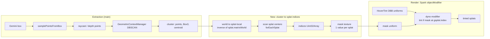
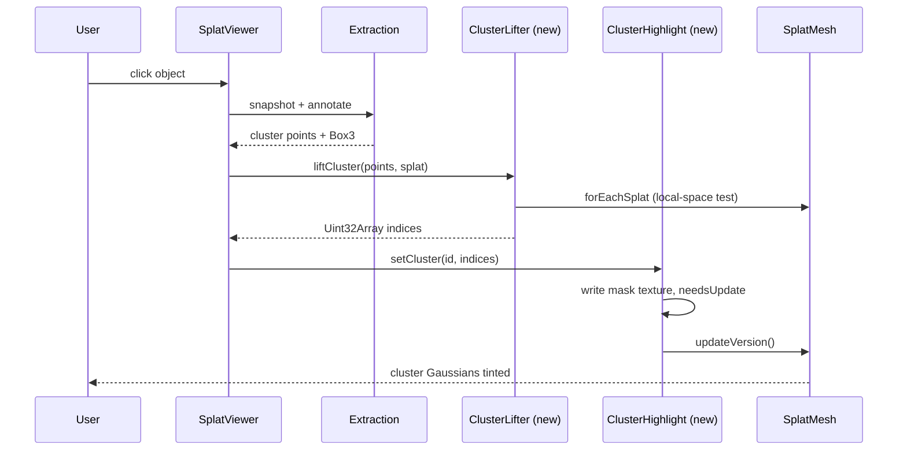

# Gaussian Cluster Highlighting — Investigation & Implementation Plan

Status: **investigation; Phase 0 spike run and passed (§8.1). Implementation not started, awaiting approval.**
Scope: how to highlight the Gaussians (splats) that belong to an extracted object in the Spark.js viewer.
Method: static reading of repository source (branch `experiment/hover-tint`, and `main` via `git show main:<path>`) and the installed Spark package. Sections 1–7 are from static reading only. The Phase 0 spike was later run in headless Chrome (§8.1), and that is the only runtime evidence. Other runtime behaviour is labelled as an assumption unless stated.

Legend: **[V]** verified from source · **[A]** assumption · **[Q]** unresolved question · **[R]** recommendation.

---

## 1. Executive summary

- The object-extraction pipeline (Gemini box → depth/raycast sampling → DBSCAN → AABB) lives on `main`. It produces a **world-space `Vector3[]` plus a `Box3` and carries no splat indices.** [V]
- The hover tint (branch `experiment/hover-tint`) highlights by testing each **splat center against an oriented box inside a Spark `objectModifier`**. It tints *every* splat inside the box, including background. [V]
- Spark 2.0.0 exposes a per-splat `gsplat.index` inside modifiers (the index into underlying storage, after LOD lookup), plus `SplatMesh.splatRgba` / `RgbaArray`. These make an **exact, index-based highlight** possible. [V]
- **[R] Recommended approach:** recover the cluster's splat indices once on the CPU (scan splat centers with `forEachSplat`, keep those inside the cluster region), upload them as a per-splat mask texture, and extend the existing modifier to tint where `mask[gsplat.index] > 0`. Keep the OBB test as the hover mechanism and as a fallback. This does not mutate splat data, supports multiple objects, and is reversible.
- Biggest risks: the single-modifier-slot conflict, world↔splat-local transforms (`quaternion (1,0,0,0)`, `y = -1.5`), LOD/paged splats (index meaning, and `splatRgba` being skipped under LOD), and the unproven depth-readback path that produces the cluster points.

---

## 2. Existing architecture

### 2.1 Extraction (on `main`) [V]

| Step | Location | Notes |
|---|---|---|
| Click → snapshot | `main:src/script.ts` `captureSnapshot` | renderer uses `preserveDrawingBuffer: true` |
| Gemini detection | `POST /api/annotate` | returns normalized box `[ymin,xmin,ymax,xmax]` |
| Box sampling | `samplePointsFromBox` | adaptive grid, 6–25 per side |
| Depth per sample | `getDepthKernel` (5×5 `gl.readPixels`, `DEPTH_COMPONENT`/`FLOAT`) with raycast fallback | depth read is probably non-functional [A] |
| Clustering | `main:src/GeometricContextManager/GeometricContextManager.ts` `registerAndMeasureObject` | DBSCAN (`density-clustering`), `eps=0.3`, `minPts=10`, largest cluster |
| Output | `{label, dimensions, centroid, points, box}` | `box` is an axis-aligned `Box3` in **world space** |
| Visual | `renderMeasurementBox` | `Box3Helper` + annotation pin |

Key limitation: the points are **ray hits on the splat surface** (a sparse sample, at most about 625 points), not the splats themselves. The cluster is a point cloud of surface samples, not a set of Gaussians.

### 2.2 Hover tint (branch `experiment/hover-tint`) [V]

- `src/utils/hoverTint.ts` holds `OBB` (world position/quaternion/size), `rayIntersectsOBB` (slab method), `pickNearestOBB` and `HoverTint`.
- `HoverTint` installs one `dyno.dynoBlock` `objectModifier` with uniforms `splatToBox` (mat4 = `inverse(boxWorld) * splat.matrixWorld`), `halfExtents`, `color`, `active`, `strength` (0.45) and `feather` (0.05).
- Shader core: transform `gsplat.center` into box space, test `abs(p) - halfExtents <= 0`, apply a feathered mask, `mix(rgb, color, strength*mask)`.
- `setHovered(obb|null)` updates uniforms and calls `splat.updateVersion()`.
- `src/script.ts`: `registerApartment`, per-frame `syncApartmentOBBs`, `setupHoverInteraction` (pointermove). `loadWorld` places the splat with `quaternion.set(1,0,0,0)` and `position.set(0,-1.5,0)`.
- On this branch the click handler pins an annotation and does **not** run the DBSCAN extraction.
- `HOVER_TINT_IMPLEMENTATION.md` states the tint "has not been verified in a browser".
- `src/utils/utils.ts` `setupSplatModifier` (effects) also writes `objectModifier`. It is currently commented out and would conflict with the hover tint.

### 2.3 Repo observations [V]

- The initial load is `loadWorld("/City_Block.ply")`, but `public/` contains only `Apartment.sog`, `Apartment-lod.rad` and `BiltmoreGaussianSplat.ply`. The target asset needs confirming. [Q]
- `VLSPLAT_INVESTIGATION.md` is a separate, pre-existing untracked document. It was not touched.

---

## 3. Verified Spark.js API findings

Package: `@sparkjsdev/spark` **2.0.0** (`node_modules/@sparkjsdev/spark/package.json`). Types are in `node_modules/@sparkjsdev/spark/dist/types/`; the implementation is `node_modules/@sparkjsdev/spark/dist/spark.module.js`.

| # | Finding | Source |
|---|---|---|
| F1 | `Gsplat` GLSL struct: `vec3 center; uint flags; vec3 scales; int index; vec4 quaternion; vec4 rgba;`. **`index` is available in modifiers.** | `spark.module.js:2744-2751` |
| F2 | Fetched splats get `gsplat.index = index` (packed/ext/cov readers). | `spark.module.js:2832, 2879, 2912, 2962` |
| F3 | Generator order: `maybeLookupIndex` → `fetchSplat` → `maybeInjectSplatRgba` (if `splatRgba`) → skinning → **`objectModifiers`** → `transform.applyGsplat` → recolor → `rgbaDisplaceEdits` → **`worldModifiers`**. | `spark.module.js:12455-12500` |
| F4 | `objectModifiers` / `worldModifiers` are **arrays**. The singular option wraps into a one-element array, and multiple modifiers chain in order. | `spark.module.js:12238-12244, 12439-12448` |
| F5 | With `enableLod`, `maybeLookupIndex` remaps the index through `lodIndices`, so `gsplat.index` is the **underlying storage index**, not the draw-order index. | `spark.module.js:12858-12895` |
| F6 | `maybeInjectSplatRgba` overwrites `rgba` from the `RgbaArray` **only when `!enableLod`** and `0 <= index < rgba.count`. | `spark.module.js:12900-12918` |
| F7 | `RgbaArray` has `count`, `needsUpdate`, `dyno`, `fromPackedSplats`, `read()`. `readRgbaArray(rgba, index)` is exported. | `dist/types/RgbaArray.d.ts` |
| F8 | `SplatMesh.forEachSplat(cb(index, center, scales, quaternion, opacity, color))`. `PackedSplats` also has `getSplat`, `setSplat`, `getNumSplats`, `extractSplats(indices, pageColoring)`. | `dist/types/SplatMesh.d.ts`, `PackedSplats.d.ts:53-104` |
| F9 | `SplatEdit` / `SplatEditSdf` are **SDF-shape based**, not per-index (sphere, box, ellipsoid, cylinder, capsule, plane…). `rgbaBlendMode` is multiply / set_rgb / add_rgba. `SplatEdits` has `maxSdfs` / `maxEdits` limits. | `dist/types/SplatEdit.d.ts` |
| F10 | Raycast returns distance/point/object only, with no splat index. `SplatMesh.raycastIndices` is an input to raycast, not an output. | `spark.module.js:12731-12732` |
| F11 | `SplatMesh` exposes `splatRgba`, `rgbaDisplaceEdits`, `edits`, `editable`, `raycastable`, `minRaycastOpacity`, `recolor`, `opacity`, `enableLod`, `paged`. | `dist/types/SplatMesh.d.ts` |

**Not verified from source** (settled at runtime — see §8.1: works): the public way to declare a custom data-texture uniform on a user `dyno.Dyno` and sample it with `texelFetch`. Spark itself uses an internal `splatTexCoord(index)` helper at `spark.module.js:12915`, and it is unknown whether that helper is visible to user modifier GLSL. [Q]

---

## 4. Facts, assumptions, questions, recommendations

### Verified facts [V]
1. The extraction output is world-space points plus an AABB, with no indices.
2. Object modifiers see `gsplat.index` and run in **splat-local space**, before `transform.applyGsplat`.
3. Hover tint uses one modifier slot, but Spark supports an array.
4. `splatRgba` injection is skipped under LOD.
5. Spark raycast gives no splat index.

### Assumptions [A]
1. The `getDepthKernel` readback yields no usable depth. WebGL2 generally does not allow `DEPTH_COMPONENT` `readPixels`, so the raycast fallback does the real work.
2. The first iteration targets a non-LOD, non-paged file.
3. A full `forEachSplat` scan of a few hundred thousand to ~1M splats takes tens to low hundreds of ms.
4. DBSCAN `eps=0.3` is in world units and the scene is roughly metre-scale.

### Unresolved questions [Q]
1. Which asset is the real target? (The initial load now points at `Apartment-lod.rad` per `e281c2b`; earlier it was `Apartment.sog`; `City_Block.ply` is missing.)
2. Is LOD or paging required for the target? (`Apartment.sog` is non-LOD, `h.lod=false`; `Apartment-lod.rad` untested, and it is now the viewer's default.) This changes index semantics and `splatRgba` availability.
3. ~~Can a user dyno bind a custom data texture?~~ **Resolved: yes** (Phase 0 run, §8.1). `dyno.dynoUsampler2D` + `usampler2D` input + `texelFetch` compiles and samples correctly.
4. Should the highlight be the *exact Gaussians in the cluster* or *all Gaussians within the cluster's region*? Sparse surface samples make "exact" fuzzy.
5. Should highlights persist per object (several at once) in addition to hover?
6. Should the extraction branch (`main`) and hover branch be merged first?

---

## 5. Approach comparison

| Approach | Precision | Cost | Reversible | Multi-object | Main drawback |
|---|---|---|---|---|---|
| A. **Per-index mask + modifier tint** | Exact set | One CPU scan + one texture | Yes | Yes (id per splat) | Needs custom texture uniform; LOD index semantics |
| B. Cluster OBB via existing `HoverTint` | Box-level | Near zero | Yes | Limited by uniforms | Tints background splats inside the box |
| C. `SplatEdit` SDF (box/ellipsoid) | Shape-level | Low | Yes | Limited by `maxSdfs/maxEdits` | Same imprecision as B; extra pipeline stage |
| D. `splatRgba` / `RgbaArray` recolor | Exact set | CPU scan + array upload | Partly | Yes | **Ignored under LOD** (F6); overwrites base colors |
| E. `extractSplats` into a sub-mesh | Exact set | Duplicates data, extra draw | Yes | Yes | Memory, sorting cost, z-fighting |
| F. CPU `setSplat` recolor | Exact set | Re-upload packed array | Needs backup | Yes | Mutates source data; heavy |

- **A** has the best result-to-effort ratio and composes with the existing modifier.
- **B** is a valid Phase 1 quick win and the correct fallback.
- **D** is simple but fragile (LOD) and destructive to color data.
- **C/E/F** add complexity without a benefit over A.

---

## 6. Recommended architecture

### 6.1 Component diagram

### 6.2 Data flow (click to highlight)

### 6.3 Design details [R]

1. **Space handling.** Transform cluster points into splat-local space with `inverse(splat.matrixWorld)` before testing against `forEachSplat` centers (which are local). This keeps the scan independent of the `(1,0,0,0)` quaternion and `y=-1.5` offset.
2. **Membership test.** Build a local-space region from the cluster points (AABB first, then a PCA-fit OBB), inflated by a configurable margin (e.g. `eps`). Optionally require a minimum opacity.
3. **Mask storage.** `Uint8Array(numSplats)` uploaded as a `THREE.DataTexture` (red channel, laid out to match Spark's texel addressing). One byte stores an object id (0 = none), allowing up to 255 objects with per-object colors from a small palette uniform.
4. **Modifier.** Generalize the `HoverTint` dyno: keep the OBB branch for hover and add `if (id > 0) rgb = mix(rgb, palette[id], strength)`, looking up the mask with `gsplat.index` (F1).
5. **Slot management.** Use `objectModifiers = [...]` (F4), or fold both effects into one dyno owned by a single `SplatHighlighter` class so the effect modifier in `utils.ts` can be appended instead of clobbering.
6. **Lifecycle.** `setCluster` / `clearCluster(id)` update the byte array, set `texture.needsUpdate = true`, then call `splat.updateVersion()`.
7. **Fallback.** If the mask-texture path is not feasible (Q3), use Approach B with an OBB fitted to the cluster.

---

## 7. File-by-file implementation plan (not started)

| File | Change |
|---|---|
| `src/utils/clusterLifter.ts` (new) | `liftCluster(splat, points, {margin, minOpacity}) → Uint32Array`: world→local transform, region test, `forEachSplat` scan. |
| `src/utils/clusterHighlight.ts` (new) | Owns the mask `Uint8Array`, `DataTexture`, palette uniform and the combined dyno modifier. API: `setCluster`, `clearCluster`, `dispose`. |
| `src/utils/hoverTint.ts` | Extract the shared dyno or accept an external modifier chain. Stop writing the singular `objectModifier` directly. |
| `src/script.ts` | Create the highlighter in `loadWorld`. After extraction, call the lifter and `setCluster`. Clear on world reload. Keep `syncApartmentOBBs`. |
| `src/GeometricContextManager/GeometricContextManager.ts` | No logic change expected; it already returns `points`. |
| `src/utils/utils.ts` | If effects are re-enabled, append to `objectModifiers`. |
| `HOVER_TINT_IMPLEMENTATION.md` / `README.md` | Document the new highlight path. |

No dependency, configuration or standalone shader-file changes are expected. GLSL stays inline in the dyno, as in `hoverTint.ts`.

---

## 8. Phased plan & validation criteria

**Phase 0 — Spikes.** *Status: done, all steps passed — see §8.1.*

| Item | Status | Notes |
|---|---|---|
| Confirm the target asset | **Changed, needs confirming** | `5dd49fd` pointed the initial load at `Apartment.sog`, but the latest commit `e281c2b` points it at `Apartment-lod.rad`. The viewer's current default is therefore probably the LOD file, while Phase 0 ran on the non-LOD `.sog`. |
| Confirm whether LOD is active | **Partly done** | `Apartment.sog`: `h.lod=false`. `Apartment-lod.rad` was **not** tested. If the viewer loads the `.rad`, index semantics (F5) and the `splatRgba` limitation (F6) apply, so repeat steps 3–4 on it before Phase 2. |
| Prove a custom mask texture binds and samples in a user dyno via `gsplat.index` | **Done, passed (non-LOD)** | `src/experiment/gaussianIdProbe.ts` builds an `R8UI` `DataTexture` (4096 wide, id → `(id & 4095, id >> 12)`), binds it with `dyno.dynoUsampler2D`, and samples it with `texelFetch`. It appends to `objectModifiers`, after `HoverTint`. |
| Validate that a hard-coded mask for splats `0..N` tints exactly those splats | **Done, passed (non-LOD)** | See §8.1. `setDebugRegion` cross-check shows CPU `forEachSplat` indices equal the shader's `gsplat.index`. |

Steps 1–6 of the original checklist are complete and recorded in §8.1. **Next spike:** repeat steps 2–4 with `?url=http://localhost:<port>/Apartment-lod.rad`.

### 8.1 Phase 0 results (run 2026-11-07)

Environment: headless Chrome via Playwright, SwiftShader (software GL), vite dev server, `probe.html?url=http://localhost:5199/Apartment.sog` (absolute URL needed; a relative one fails inside Spark's blob worker). Camera at world (0, 0.4, 0) looking -z, 640x480.

| Step | Result |
|---|---|
| 1. Shader/GL errors | **Pass.** No shader compile errors, `gl.getError()` empty after all runs. Only console error was one unrelated 404 (cause not identified). |
| 2. `h.lod`, `h.numSplats` | `lod=false`, `numSplats=699086`, `objectModifiers.length=2`. Splat-local center bounds x[-4.55,5.05] y[-5.04,1.15] z[-7.52,7.30]. |
| 3. `replace(ids)` then `diff()` | **Pass.** Control (two baseline renders) diff = 0. ids `0..19999` changed 0 px (off-screen from this camera; inconclusive on its own). 5078 splats from a visible region changed 26079 px, 0 of them outside the projected bbox of those splats (+40 px). `clear()` and `replace([])` return exactly to baseline (diff 0). |
| 4. `setDebugRegion` vs mask | **Pass.** 35503 CPU ids from `forEachSplat` in a local box: mask image vs shader-region image diff = **0** px (71283 px differ from baseline). Negative control (ids shifted by 1) differs by 15633 px. So CPU `forEachSplat` index == shader `gsplat.index` (non-LOD). |
| 5. Composes with `HoverTint` | **Pass.** Hover only 9239 px, probe only 26079 px, both 28603 px; both-vs-hover 26632, both-vs-probe 7807. Both effects visible together with 2 modifiers in the array. |

Caveats: "only those splats change" is bounded by projected-bbox and region-equality evidence, not a per-splat proof. Software GL, one camera pose. Non-LOD `.sog` only; LOD/`.rad` index semantics (F5) still untested. The Q3 outcome means Approach A is **not** blocked; no fallback to B needed.

**Phase 1 — Coordinates and OBB baseline.**
- Merge extraction and hover-tint work. Fit an OBB to the cluster and feed it to `HoverTint`.
- *Validate:* the highlight sits on the clicked object, and it stays aligned when the splat is moved or rotated.

**Phase 2 — Index lifting.**
- Implement `clusterLifter` and render via the mask.
- *Validate:* the highlighted count is plausible for the object. Background splats inside the box but outside the margin are **not** tinted. The result is invariant under splat transform changes.

**Phase 3 — Integration.**
- Add multi-object ids, the palette, clear/dispose, and coexistence with hover and the effect modifier.
- *Validate:* two objects highlight at once, hover and persistent highlight both show, there are no GL or console errors, and reload clears state.

**Phase 4 — Hardening.**
- Optional LOD/paged support, Web Worker scan, opacity filtering, UX tuning.
- *Validate:* idle frame time is unchanged and the scan fits the time budget (§9).

---

### 8.2 Phase 1 results — Coordinates and OBB baseline (run 2026-11-07)

Labels: **[S]** source-verified, **[B]** browser-validated (see environment), **[U]** not validated.

**Integration strategy [S].** `main`'s extraction pipeline was merged into the hover-tint/probe branch (`bdf6386`, `git merge main`). The `script.ts` conflicts were resolved by keeping both sides. `public/Apartment-lod.rad` is kept. The initial URL is `Apartment-lod.rad` (set by `e281c2b`), but all Phase 1 browser tests loaded the non-LOD `Apartment.sog` through the validation scripts, so the `.rad` default is untested [U]. The extraction algorithm (depth/raycast sampling, DBSCAN eps 0.3 / minPts 10) is unchanged. The new step runs after `renderMeasurementBox` in `annotateFromDetection`.

**OBB algorithm [S][B].** `src/utils/obbFit.ts`, no new dependency.
1. Centroid and 3x3 covariance of the accepted cluster's world-space points.
2. Jacobi eigen-decomposition. Axes are sorted by descending eigenvalue, sign-normalised, and re-orthogonalised into a right-handed frame (z = x cross y).
3. Project the points on the axes, take min/max, then centre and size, plus a 0.02 margin per side.
4. AABB fallback (identity rotation) when n < 4, the largest eigenvalue <= 1e-10, or the second eigenvalue < 1e-6 x the first (collinear points).

Observed in the browser: PCA for n=28 and n=77; AABB fallback for n=132 (points collinear: x/z size equals the 0.04 margin alone) and n=44 (cause not investigated). Fit plus uploading it to the shader took 0.2-0.5 ms in all four runs [B].

**Coordinate chain [S].**
- Extracted points are world space (raycast/depth unprojection). `fitOBB` returns a world OBB.
- `obbWorldToLocal(world, splat)` re-expresses it in splat-local space: `local = inverse(splat.matrixWorld) * world`, rotation composed with the inverse's rotation, size scaled by the mean |scale| of the inverse. This **assumes uniform scale**; non-uniform scale is not handled [U].
- In Spark's `objectModifier`, `gsplat.center` is splat-local, so the shader tests `inverse(obbLocal) * center` against the half extents. The scene transform is read from `splat.matrixWorld`; nothing is hardcoded. The initial transform here happens to be quaternion (x,y,z,w) = (1,0,0,0) (a 180 degree flip about X) and position (0,-1.5,0), which makes the flip a real test of the conversion.
- **Anchoring decision:** the OBB is stored splat-local, so it follows the splat with no refit and no re-upload. A second `HoverTint` instance (`space:"splat"`, orange) holds the persistent highlight, so hover's `setHovered(null)` cannot clear it. `space:"world"` plus `syncSplatTransform()` (per-frame `matrixWorld` compare; refresh and `updateVersion` only on change) exists for world-anchored use. It is source-reviewed only and **not** exercised by a test [U].

**Status summary.** Phase 1 is complete (commit `5066223`). After a detection, the app fits a PCA OBB to the accepted cluster, converts it to splat-local space and tints the enclosed Gaussians orange. The tint follows the splat with no refit. Open items before Phase 2: GPU-browser re-run of A-F, `.rad`/LOD check, world-mode sync test, per-detection alignment check, and the stale-frame cause.

**Browser environment.** Playwright, headless Chrome with SwiftShader (software GL), vite dev server, `Apartment.sog` (699,086 splats), 400x300. `page.screenshot` hangs under SwiftShader, so frames are read with `canvas.toDataURL` (`window.__sl.capture()`, a DEV-only hook). **Gemini was not exercised**: a fixed 2D box is injected through `annotateFromDetection` via `__sl.inject`. Scripts: `scripts/phase1-validate.mjs` (A-F) and `scripts/phase1-diag.mjs` (alignment re-check with a 6 s settle). Raw output: `docs/phase1-screenshots/results.json` and `diag.json`; screenshots are in the same directory.

| Test | Result |
|---|---|
| **A. Basic highlight** | **Pass [B].** Box [0.3,0.3,0.7,0.7] gives a PCA OBB (n=28, size 0.91x0.31x0.12). The tinted region sits inside the OBB wireframe (`A-basic-highlight.png`); 2307 px differ from baseline in bbox [192,128,220,213]. CPU count of splat centres inside the OBB = 893. |
| **B. Current transform** | **Pass [B].** The local OBB centre pushed through `splat.matrixWorld` equals the world fit centre, error 1.1e-16 (with the 180 degree flip and y offset in place). The CPU count in world space equals the count in local space (893 = 893). |
| **C. Translation** (x += 0.5, no refit) | **Pass [B] on re-check.** The CPU local count stays 893. With a 6 s settle the tint bbox [153,122,176,213] lies within the helper's projected bbox [148,126,177,209] (`diag-transX0.5-on.png`). A stale world-space count is 0, which shows why world anchoring would need a refit. The first run (1.5 s settle) produced a corrupted frame (`C-translated.png`, dark smeared splats); its pixel diffs (C_diffVsA, C_tintDiff) are **not meaningful** and the cause is not identified. |
| **D. Rotation** (30 degrees about Y) | **Pass [B] on re-check.** Rotation only: tint bbox [197,121,218,214] against helper [192,126,220,209]. Rotation plus the earlier translation: still aligned. The CPU local count stays 893. The helper is parented to the splat. |
| **E. Transform refresh** | **Pass for the splat-space design [B]; world-mode refresh [U].** `updateVersion` calls: 0 over 1 s idle, 0 over 1 s after moving the splat. The cluster highlight needs no refresh because it is splat-local. `syncSplatTransform()` for `space:"world"` was not tested. |
| **F. Multiple sequential detections** | **Partial [B].** Three further injected boxes each fitted and highlighted. The wireframe helper count stayed at 1 (old helper disposed, no leak), and a new fit replaces the previous highlight. CPU counts were 1, 16386 and 4; the first and third boxes are tiny or hit sparse regions, and the second is a large 1.76x1.41x0.55 m box, so these are not clean "objects". The per-frame pixel diffs from this run used a 1.5 s settle and are unreliable, so alignment was not re-checked per detection. |

Note on the blue box in the screenshots: it is the existing world-space measurement box (`renderMeasurementBox`). It is not attached to the splat, so it stays put when the splat moves, while the orange OBB tint and wireframe move with the splat. This is expected; it makes the translated and rotated screenshots show the orange region leaving the blue box.

**Alignment evidence.** The check compares the projected screen bbox of the helper (scene graph, parented to the splat) with the bbox of the tint-on/off pixel difference (the shader), for identity, rotation and translation. They agree to within about 5 px in each case (identity: tint [193,129,218,213], helper [192,126,220,208]). This shows the shader highlight and the scene-graph OBB move together with the splat. It does not independently prove that the highlighted Gaussians are the true object, only that they are the ones inside the OBB fitted to the cluster (893 centres counted on the CPU).

**Observed instability under SwiftShader.** With a 1.5 s settle, frames after a transform change were sometimes stale or corrupted (the first C run, and the D screenshot where the tint lagged one transform behind the splat). With a 6 s settle all three cases were clean. I did not determine whether this is Spark's accumulator/sort lagging at a very low frame rate or a harness effect. **It has not been tested on a GPU browser [U].**

**Limitations and risks.**
- Box membership, not per-splat association: Gaussians inside the OBB but in front of or behind the object are tinted (Phase 2 addresses this). 893 splats were inside the Test A box.
- OBB quality depends on the cluster; thin or collinear clusters fall back to an axis-aligned box in world space, which is loose for rotated objects.
- Uniform scale only. `Apartment.sog` only; LOD/`.rad` not tested [U]. Gemini end to end not tested [U]. Software GL only, one camera pose, 400x300 [U].
- The OBB is captured at detection time and is not re-fit when the splat is edited.
- Pre-existing and unrelated: `main.ts` throws on a null `generateBtn` at startup (does not block loading).

**Phase 2 recommendation.** Replace box membership with per-splat association: collect the splat indices whose centre falls inside the OBB and whose projection lies in the cluster's depth-consistent pixels, and render them via a mask (Phase 0 showed CPU `forEachSplat` index equals shader `gsplat.index` for non-LOD). Keep the splat-local OBB as the coarse prefilter. Before that, re-run A-F on a GPU browser and settle the stale-frame question.

---

## 9. Performance considerations

- **CPU scan:** O(N) over splats, once per extraction. Target under 200 ms for ~1M splats [A]. If exceeded, move to a Worker over `packedArray`, or build a coarse grid for region queries.
- **Per-frame GPU cost:** one extra texture fetch per splat in the generator pass, which is small next to sorting and rendering. The existing hover test is one mat4×vec3 per splat.
- **Regeneration:** `updateVersion()` regenerates splat data on the GPU, so call it only on state changes (click, hover change), not per frame.
- **Memory:** the mask costs 1 byte/splat (about 1 MB per million), versus a full copy of splat data for Approach E.
- **Readback:** keep `readPixels` depth out of the hot path and rely on raycast sampling.

---

## 10. Risks

| Risk | Impact | Mitigation |
|---|---|---|
| Single modifier slot clash (hover vs. effects vs. highlight) | Silent override of effects | One owning class, or the `objectModifiers` array |
| World vs. splat-local confusion | Offset or mirrored highlight | Always use `inverse(matrixWorld)`; Phase 1 transform test |
| LOD / paged index semantics; `splatRgba` skipped under LOD | Wrong or missing highlight | Target non-LOD first; Phase 4 for LOD |
| Cluster is sparse surface samples | Misses interior or back splats | Inflate margin; OBB region; grow by splat scale |
| Gemini box wrong / DBSCAN picks wrong cluster | Wrong object highlighted | Out of scope; surface the box for debugging |
| Depth readback not functional | Fewer, poorer points | Rely on raycast; verify in Phase 0 |
| ~~Custom texture uniform unsupported in user dynos~~ | Retired: Phase 0 showed it works (§8.1) | None needed |
| Branch divergence (`main` vs `experiment/hover-tint`) | Merge conflicts | Decide branch strategy first (Q6) |
| Hover tint unverified in browser | Unknown baseline bugs | Phase 1 smoke test before building on it |

---

## 11. Open questions (summary)

1. Which asset is the target (`City_Block.ply` is missing)?
2. Is LOD/paged rendering required?
3. Is "all splats in the cluster region" acceptable, or is a stricter "exact cluster" needed?
4. Should several objects be highlighted at once, and with which colors?
5. Branch strategy: build on `experiment/hover-tint`, `main`, or a merge?
6. Is the hover tint, still unverified in a browser, a trusted baseline?

---

## 12. Final recommendation

**Implement Approach A (per-splat mask texture plus an `objectModifier` tint keyed by `gsplat.index`) in phases. Use Approach B (cluster-fitted OBB through the existing `HoverTint`) as the Phase 1 baseline and as the fallback.**

Rationale:
- It is the only option that highlights *the Gaussians of the object*, rather than whatever sits inside a box, at a small one-time cost (one CPU scan, about 1 byte/splat).
- It is non-destructive and reversible. Original colors stay intact (unlike D and F) and no duplicate geometry is drawn (unlike E).
- It reuses the proven modifier mechanism and hover-tint code. Spark exposes the needed hook (`gsplat.index`, F1/F2) and modifier chaining (F4).
- The one real technical unknown (custom texture binding) sits behind a cheap Phase 0 spike, and the OBB fallback means the feature ships in some form either way.

**No implementation will begin until explicitly approved.**
