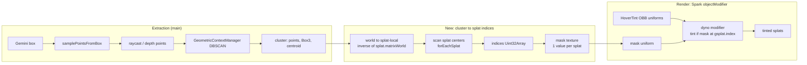
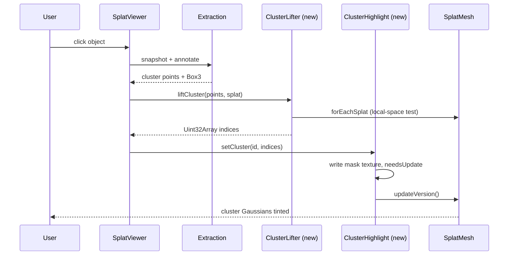

# Gaussian Cluster Highlighting — Investigation & Implementation Plan

Status: **investigation only — no implementation started, awaiting approval.**
Scope: how to highlight the Gaussians (splats) that belong to an extracted object in the Spark.js viewer.
Method: static reading of repository source (branch `experiment/hover-tint`, and `main` via `git show main:<path>`) and the installed Spark package. **Nothing was executed in a browser.** Runtime behaviour is labelled as an assumption unless stated.

Legend: **[V]** verified from source · **[A]** assumption · **[Q]** unresolved question · **[R]** recommendation.

---

## 1. Executive summary

- The object-extraction pipeline (Gemini box → depth/raycast sampling → DBSCAN → AABB) lives on `main`. It produces a **world-space `Vector3[]` plus a `Box3` and carries no splat indices.** [V]
- The hover tint (branch `experiment/hover-tint`) highlights by testing each **splat center against an oriented box inside a Spark `objectModifier`**. It tints *every* splat inside the box, including background. [V]
- Spark 2.0.0 exposes a per-splat `gsplat.index` inside modifiers (the index into underlying storage, after LOD lookup), plus `SplatMesh.splatRgba` / `RgbaArray`. These make an **exact, index-based highlight** possible. [V]
- **[R] Recommended approach:** recover the cluster's splat indices once on the CPU (scan splat centers with `forEachSplat`, keep those inside the cluster region), upload them as a per-splat mask texture, and extend the existing modifier to tint where `mask[gsplat.index] > 0`. Keep the OBB test as the hover mechanism and as a fallback. This does not mutate splat data, supports multiple objects, and is reversible.
- Biggest risks: the single-modifier-slot conflict, world↔splat-local transforms (`quaternion (1,0,0,0)`, `y = -1.5`), LOD/paged splats (index meaning, and `splatRgba` being skipped under LOD), and the unproven depth-readback path that produces the cluster points.

---

## 2. Existing architecture

### 2.1 Extraction (on `main`) [V]

| Step | Location | Notes |
|---|---|---|
| Click → snapshot | `main:src/script.ts` `captureSnapshot` | renderer uses `preserveDrawingBuffer: true` |
| Gemini detection | `POST /api/annotate` | returns normalized box `[ymin,xmin,ymax,xmax]` |
| Box sampling | `samplePointsFromBox` | adaptive grid, 6–25 per side |
| Depth per sample | `getDepthKernel` (5×5 `gl.readPixels`, `DEPTH_COMPONENT`/`FLOAT`) with raycast fallback | depth read is probably non-functional [A] |
| Clustering | `main:src/GeometricContextManager/GeometricContextManager.ts` `registerAndMeasureObject` | DBSCAN (`density-clustering`), `eps=0.3`, `minPts=10`, largest cluster |
| Output | `{label, dimensions, centroid, points, box}` | `box` is an axis-aligned `Box3` in **world space** |
| Visual | `renderMeasurementBox` | `Box3Helper` + annotation pin |

Key limitation: the points are **ray hits on the splat surface** (a sparse sample, at most about 625 points), not the splats themselves. The cluster is a point cloud of surface samples, not a set of Gaussians.

### 2.2 Hover tint (branch `experiment/hover-tint`) [V]

- `src/utils/hoverTint.ts` holds `OBB` (world position/quaternion/size), `rayIntersectsOBB` (slab method), `pickNearestOBB` and `HoverTint`.
- `HoverTint` installs one `dyno.dynoBlock` `objectModifier` with uniforms `splatToBox` (mat4 = `inverse(boxWorld) * splat.matrixWorld`), `halfExtents`, `color`, `active`, `strength` (0.45) and `feather` (0.05).
- Shader core: transform `gsplat.center` into box space, test `abs(p) - halfExtents <= 0`, apply a feathered mask, `mix(rgb, color, strength*mask)`.
- `setHovered(obb|null)` updates uniforms and calls `splat.updateVersion()`.
- `src/script.ts`: `registerApartment`, per-frame `syncApartmentOBBs`, `setupHoverInteraction` (pointermove). `loadWorld` places the splat with `quaternion.set(1,0,0,0)` and `position.set(0,-1.5,0)`.
- On this branch the click handler pins an annotation and does **not** run the DBSCAN extraction.
- `HOVER_TINT_IMPLEMENTATION.md` states the tint "has not been verified in a browser".
- `src/utils/utils.ts` `setupSplatModifier` (effects) also writes `objectModifier`. It is currently commented out and would conflict with the hover tint.

### 2.3 Repo observations [V]

- The initial load is `loadWorld("/City_Block.ply")`, but `public/` contains only `Apartment.sog`, `Apartment-lod.rad` and `BiltmoreGaussianSplat.ply`. The target asset needs confirming. [Q]
- `VLSPLAT_INVESTIGATION.md` is a separate, pre-existing untracked document. It was not touched.

---

## 3. Verified Spark.js API findings

Package: `@sparkjsdev/spark` **2.0.0** (`node_modules/@sparkjsdev/spark/package.json`). Types are in `node_modules/@sparkjsdev/spark/dist/types/`; the implementation is `node_modules/@sparkjsdev/spark/dist/spark.module.js`.

| # | Finding | Source |
|---|---|---|
| F1 | `Gsplat` GLSL struct: `vec3 center; uint flags; vec3 scales; int index; vec4 quaternion; vec4 rgba;`. **`index` is available in modifiers.** | `spark.module.js:2744-2751` |
| F2 | Fetched splats get `gsplat.index = index` (packed/ext/cov readers). | `spark.module.js:2832, 2879, 2912, 2962` |
| F3 | Generator order: `maybeLookupIndex` → `fetchSplat` → `maybeInjectSplatRgba` (if `splatRgba`) → skinning → **`objectModifiers`** → `transform.applyGsplat` → recolor → `rgbaDisplaceEdits` → **`worldModifiers`**. | `spark.module.js:12455-12500` |
| F4 | `objectModifiers` / `worldModifiers` are **arrays**. The singular option wraps into a one-element array, and multiple modifiers chain in order. | `spark.module.js:12238-12244, 12439-12448` |
| F5 | With `enableLod`, `maybeLookupIndex` remaps the index through `lodIndices`, so `gsplat.index` is the **underlying storage index**, not the draw-order index. | `spark.module.js:12858-12895` |
| F6 | `maybeInjectSplatRgba` overwrites `rgba` from the `RgbaArray` **only when `!enableLod`** and `0 <= index < rgba.count`. | `spark.module.js:12900-12918` |
| F7 | `RgbaArray` has `count`, `needsUpdate`, `dyno`, `fromPackedSplats`, `read()`. `readRgbaArray(rgba, index)` is exported. | `dist/types/RgbaArray.d.ts` |
| F8 | `SplatMesh.forEachSplat(cb(index, center, scales, quaternion, opacity, color))`. `PackedSplats` also has `getSplat`, `setSplat`, `getNumSplats`, `extractSplats(indices, pageColoring)`. | `dist/types/SplatMesh.d.ts`, `PackedSplats.d.ts:53-104` |
| F9 | `SplatEdit` / `SplatEditSdf` are **SDF-shape based**, not per-index (sphere, box, ellipsoid, cylinder, capsule, plane…). `rgbaBlendMode` is multiply / set_rgb / add_rgba. `SplatEdits` has `maxSdfs` / `maxEdits` limits. | `dist/types/SplatEdit.d.ts` |
| F10 | Raycast returns distance/point/object only, with no splat index. `SplatMesh.raycastIndices` is an input to raycast, not an output. | `spark.module.js:12731-12732` |
| F11 | `SplatMesh` exposes `splatRgba`, `rgbaDisplaceEdits`, `edits`, `editable`, `raycastable`, `minRaycastOpacity`, `recolor`, `opacity`, `enableLod`, `paged`. | `dist/types/SplatMesh.d.ts` |

**Not verified from source** (to settle in Phase 0): the public way to declare a custom data-texture uniform on a user `dyno.Dyno` and sample it with `texelFetch`. Spark itself uses an internal `splatTexCoord(index)` helper at `spark.module.js:12915`, and it is unknown whether that helper is visible to user modifier GLSL. [Q]

---

## 4. Facts, assumptions, questions, recommendations

### Verified facts [V]
1. The extraction output is world-space points plus an AABB, with no indices.
2. Object modifiers see `gsplat.index` and run in **splat-local space**, before `transform.applyGsplat`.
3. Hover tint uses one modifier slot, but Spark supports an array.
4. `splatRgba` injection is skipped under LOD.
5. Spark raycast gives no splat index.

### Assumptions [A]
1. The `getDepthKernel` readback yields no usable depth. WebGL2 generally does not allow `DEPTH_COMPONENT` `readPixels`, so the raycast fallback does the real work.
2. The first iteration targets a non-LOD, non-paged file.
3. A full `forEachSplat` scan of a few hundred thousand to ~1M splats takes tens to low hundreds of ms.
4. DBSCAN `eps=0.3` is in world units and the scene is roughly metre-scale.

### Unresolved questions [Q]
1. Which asset is the real target (`City_Block.ply` is missing)?
2. Is LOD or paging required for the target? This changes index semantics and `splatRgba` availability.
3. Can a user dyno bind a custom data texture?
4. Should the highlight be the *exact Gaussians in the cluster* or *all Gaussians within the cluster's region*? Sparse surface samples make "exact" fuzzy.
5. Should highlights persist per object (several at once) in addition to hover?
6. Should the extraction branch (`main`) and hover branch be merged first?

---

## 5. Approach comparison

| Approach | Precision | Cost | Reversible | Multi-object | Main drawback |
|---|---|---|---|---|---|
| A. **Per-index mask + modifier tint** | Exact set | One CPU scan + one texture | Yes | Yes (id per splat) | Needs custom texture uniform; LOD index semantics |
| B. Cluster OBB via existing `HoverTint` | Box-level | Near zero | Yes | Limited by uniforms | Tints background splats inside the box |
| C. `SplatEdit` SDF (box/ellipsoid) | Shape-level | Low | Yes | Limited by `maxSdfs/maxEdits` | Same imprecision as B; extra pipeline stage |
| D. `splatRgba` / `RgbaArray` recolor | Exact set | CPU scan + array upload | Partly | Yes | **Ignored under LOD** (F6); overwrites base colors |
| E. `extractSplats` into a sub-mesh | Exact set | Duplicates data, extra draw | Yes | Yes | Memory, sorting cost, z-fighting |
| F. CPU `setSplat` recolor | Exact set | Re-upload packed array | Needs backup | Yes | Mutates source data; heavy |

- **A** has the best result-to-effort ratio and composes with the existing modifier.
- **B** is a valid Phase 1 quick win and the correct fallback.
- **D** is simple but fragile (LOD) and destructive to color data.
- **C/E/F** add complexity without a benefit over A.

---

## 6. Recommended architecture

### 6.1 Component diagram

### 6.2 Data flow (click to highlight)

### 6.3 Design details [R]

1. **Space handling.** Transform cluster points into splat-local space with `inverse(splat.matrixWorld)` before testing against `forEachSplat` centers (which are local). This keeps the scan independent of the `(1,0,0,0)` quaternion and `y=-1.5` offset.
2. **Membership test.** Build a local-space region from the cluster points (AABB first, then a PCA-fit OBB), inflated by a configurable margin (e.g. `eps`). Optionally require a minimum opacity.
3. **Mask storage.** `Uint8Array(numSplats)` uploaded as a `THREE.DataTexture` (red channel, laid out to match Spark's texel addressing). One byte stores an object id (0 = none), allowing up to 255 objects with per-object colors from a small palette uniform.
4. **Modifier.** Generalize the `HoverTint` dyno: keep the OBB branch for hover and add `if (id > 0) rgb = mix(rgb, palette[id], strength)`, looking up the mask with `gsplat.index` (F1).
5. **Slot management.** Use `objectModifiers = [...]` (F4), or fold both effects into one dyno owned by a single `SplatHighlighter` class so the effect modifier in `utils.ts` can be appended instead of clobbering.
6. **Lifecycle.** `setCluster` / `clearCluster(id)` update the byte array, set `texture.needsUpdate = true`, then call `splat.updateVersion()`.
7. **Fallback.** If the mask-texture path is not feasible (Q3), use Approach B with an OBB fitted to the cluster.

---

## 7. File-by-file implementation plan (not started)

| File | Change |
|---|---|
| `src/utils/clusterLifter.ts` (new) | `liftCluster(splat, points, {margin, minOpacity}) → Uint32Array`: world→local transform, region test, `forEachSplat` scan. |
| `src/utils/clusterHighlight.ts` (new) | Owns the mask `Uint8Array`, `DataTexture`, palette uniform and the combined dyno modifier. API: `setCluster`, `clearCluster`, `dispose`. |
| `src/utils/hoverTint.ts` | Extract the shared dyno or accept an external modifier chain. Stop writing the singular `objectModifier` directly. |
| `src/script.ts` | Create the highlighter in `loadWorld`. After extraction, call the lifter and `setCluster`. Clear on world reload. Keep `syncApartmentOBBs`. |
| `src/GeometricContextManager/GeometricContextManager.ts` | No logic change expected; it already returns `points`. |
| `src/utils/utils.ts` | If effects are re-enabled, append to `objectModifiers`. |
| `HOVER_TINT_IMPLEMENTATION.md` / `README.md` | Document the new highlight path. |

No dependency, configuration or standalone shader-file changes are expected. GLSL stays inline in the dyno, as in `hoverTint.ts`.

---

## 8. Phased plan & validation criteria

**Phase 0 — Spikes.**
- Confirm the target asset and whether LOD is active.
- Prove a custom mask texture can be bound and sampled in a user dyno via `gsplat.index`.
- *Validate:* a hard-coded mask for splats `0..N` visibly tints exactly those splats.

**Phase 1 — Coordinates and OBB baseline.**
- Merge extraction and hover-tint work. Fit an OBB to the cluster and feed it to `HoverTint`.
- *Validate:* the highlight sits on the clicked object, and it stays aligned when the splat is moved or rotated.

**Phase 2 — Index lifting.**
- Implement `clusterLifter` and render via the mask.
- *Validate:* the highlighted count is plausible for the object. Background splats inside the box but outside the margin are **not** tinted. The result is invariant under splat transform changes.

**Phase 3 — Integration.**
- Add multi-object ids, the palette, clear/dispose, and coexistence with hover and the effect modifier.
- *Validate:* two objects highlight at once, hover and persistent highlight both show, there are no GL or console errors, and reload clears state.

**Phase 4 — Hardening.**
- Optional LOD/paged support, Web Worker scan, opacity filtering, UX tuning.
- *Validate:* idle frame time is unchanged and the scan fits the time budget (§9).

---

## 9. Performance considerations

- **CPU scan:** O(N) over splats, once per extraction. Target under 200 ms for ~1M splats [A]. If exceeded, move to a Worker over `packedArray`, or build a coarse grid for region queries.
- **Per-frame GPU cost:** one extra texture fetch per splat in the generator pass, which is small next to sorting and rendering. The existing hover test is one mat4×vec3 per splat.
- **Regeneration:** `updateVersion()` regenerates splat data on the GPU, so call it only on state changes (click, hover change), not per frame.
- **Memory:** the mask costs 1 byte/splat (about 1 MB per million), versus a full copy of splat data for Approach E.
- **Readback:** keep `readPixels` depth out of the hot path and rely on raycast sampling.

---

## 10. Risks

| Risk | Impact | Mitigation |
|---|---|---|
| Single modifier slot clash (hover vs. effects vs. highlight) | Silent override of effects | One owning class, or the `objectModifiers` array |
| World vs. splat-local confusion | Offset or mirrored highlight | Always use `inverse(matrixWorld)`; Phase 1 transform test |
| LOD / paged index semantics; `splatRgba` skipped under LOD | Wrong or missing highlight | Target non-LOD first; Phase 4 for LOD |
| Cluster is sparse surface samples | Misses interior or back splats | Inflate margin; OBB region; grow by splat scale |
| Gemini box wrong / DBSCAN picks wrong cluster | Wrong object highlighted | Out of scope; surface the box for debugging |
| Depth readback not functional | Fewer, poorer points | Rely on raycast; verify in Phase 0 |
| Custom texture uniform unsupported in user dynos | Plan A blocked | Fall back to Approach B (or D if non-LOD) |
| Branch divergence (`main` vs `experiment/hover-tint`) | Merge conflicts | Decide branch strategy first (Q6) |
| Hover tint unverified in browser | Unknown baseline bugs | Phase 1 smoke test before building on it |

---

## 11. Open questions (summary)

1. Which asset is the target (`City_Block.ply` is missing)?
2. Is LOD/paged rendering required?
3. Is "all splats in the cluster region" acceptable, or is a stricter "exact cluster" needed?
4. Should several objects be highlighted at once, and with which colors?
5. Branch strategy: build on `experiment/hover-tint`, `main`, or a merge?
6. Is the hover tint, still unverified in a browser, a trusted baseline?

---

## 12. Final recommendation

**Implement Approach A (per-splat mask texture plus an `objectModifier` tint keyed by `gsplat.index`) in phases. Use Approach B (cluster-fitted OBB through the existing `HoverTint`) as the Phase 1 baseline and as the fallback.**

Rationale:
- It is the only option that highlights *the Gaussians of the object*, rather than whatever sits inside a box, at a small one-time cost (one CPU scan, about 1 byte/splat).
- It is non-destructive and reversible. Original colors stay intact (unlike D and F) and no duplicate geometry is drawn (unlike E).
- It reuses the proven modifier mechanism and hover-tint code. Spark exposes the needed hook (`gsplat.index`, F1/F2) and modifier chaining (F4).
- The one real technical unknown (custom texture binding) sits behind a cheap Phase 0 spike, and the OBB fallback means the feature ships in some form either way.

**No implementation will begin until explicitly approved.**
